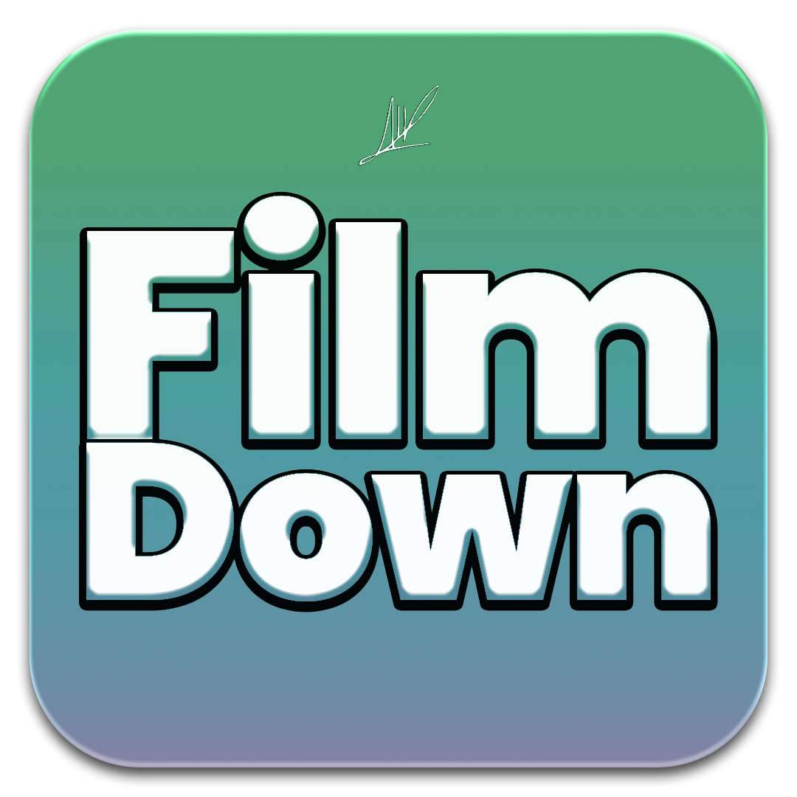

# FilmDown
### Ultra High Quality Video & Media Downloader
> Powered by Alptuğ Dağ

<p align="center">
  
</p>

<p align="center">
  
  
  
  
</p>

---

## Hakkında

**FilmDown**, internet üzerindeki video akışlarını, HLS/M3U8 yayınlarını ve sosyal medya platformlarındaki içerikleri en yüksek çözünürlük ve ses kalitesinde (`bestvideo+bestaudio/best`) indiren, macOS için yerel **Liquid Glass** arayüzüne sahip yeni nesil bir masaüstü uygulamasıdır.

Geliştirici: **Alptuğ Dağ**

---

## Öne Çıkan Özellikler (Sürüm 2.1)

- **Sabit ve Responsive Pencere:** Pencere boyutu ideal ölçüde sabitlenmiştir (660x610); ekran boyutlandırma hataları engellenmiş, kartlar, kuyruk listesi ve butonlar pencere içine duyarlı (responsive) olarak yerleşecek şekilde tasarlanmıştır.
- **Her Video İçin Ayrı Hedef Klasör:** İndirme kuyruğundaki her videonun nereye kaydedileceğini bağımsız olarak belirleyebilirsiniz. Her videonun yanında bulunan "Klasör Seç" butonu ile her bağlantıya özel bir klasör atanabilir.
- **Kalıcı Çakışma Koruması (Anti-Collision):** Çakışma koruması varsayılan ve kalıcı olarak devrededir (seçenek değildir). Aynı başlığa sahip dosya veya klasörler asla birbirinin üzerine yazılmaz; sistem otomatik olarak `(1)`, `(2)` şeklinde artımlı adlandırarak tüm verileri korur.
- **Liquid Glass Arayüz:** macOS yerel görsel efekt motoru (`NSVisualEffectView`, acrylic frosted glass) ile şeffaf buzlu cam estetiği.
- **Yalın Yükleme Çubuğu:** Ham terminal/konsol çıktısı yerine yumuşak geçişli yüzdelik oran, indirme hızı ve kalan süreyi gösteren modern loading bar.
- **Sıfır Uyarı ve Anında Başlatma:** Mach-O 64-bit yerel ikili dosya olarak sıfır gecikmeyle açılır; Python sürüm/konsol uyarıları filtrelenmiştir.
- **Emojisiz Tasarım:** Tamamen profesyonel, temiz ve modern bir görsel dil.

---

## Sistem Gereksinimleri

- **macOS 12.0+** (Apple Silicon ve Intel)
- **ffmpeg** (video ve sesi birleştirmek için):
  ```bash
  brew install ffmpeg
  ```
- **yt-dlp**:
  ```bash
  brew install yt-dlp
  # veya
  pip3 install yt-dlp
  ```

---

## Derleme ve Kurulum

### Yerel macOS Uygulamasını Derleme (`FilmDown.app`)
Projeyi klonladıktan sonra yerel Swift Mach-O uygulamasını derleyebilirsiniz:
```bash
make build
```

Masaüstündeki çalışma klasörüne doğrudan kurmak için:
```bash
make install
```

### Python Üzerinden Çalıştırma (Çapraz Platform)
```bash
pip install -r requirements.txt
python3 app.py
```

---

## Yapımcı & İletişim

**Alptuğ Dağ**  
GitHub: [@AlptugDag](https://github.com/AlptugDag)

---

## Lisans
Bu proje [MIT](LICENSE) lisansı ile korunmaktadır.
